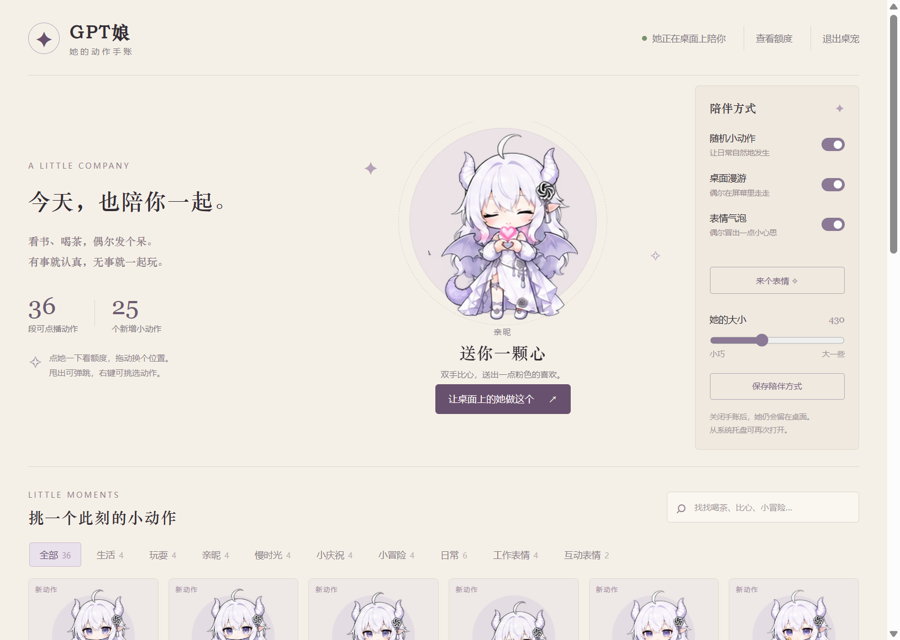

# codex-pet-龙娘

白发紫瞳的小龙娘独立桌宠，陪你在桌面上喝茶、发呆、偶尔坏笑。


**36 段动作 · 6 张 Q 版表情 · 24 条短台词 · 点击查看 Codex 额度**

## 安装与启动

当前版本支持 Windows 10/11，需要 Node.js 22.12 或以上版本，以及 Git。已在 Node.js 24.15.0 上验证。

```powershell
git clone https://github.com/Heran-ming/codex-pet-longniang.git
cd codex-pet-longniang
powershell -NoProfile -ExecutionPolicy Bypass -File .\setup.ps1
npm start
```

首次准备会安装锁定的 npm 依赖，并准备 Electron 运行环境。优先复用 GPT_PET_ELECTRON_PATH 指定的运行时或已有的 ~/.dsh/electron；缺少时下载至本项目的 runtime/electron。下载脚本来自 dsh-pet，默认使用 npmmirror 并校验资源。

需要桌面和开始菜单快捷方式时，运行：

```powershell
powershell -NoProfile -ExecutionPolicy Bypass -File .\install-local.ps1
```

快捷方式默认安装至当前用户的 LocalAppData/Programs/GPT-Pet-Companion，不自动添加开机启动。退出后再次运行 npm start 或桌面快捷方式即可。

## 怎么和她互动

- **单击人物**：坏笑后弹出真实 Codex 剩余额度，配上「本小姐可不便宜」。显示 5 小时、每周剩余比例和各自重置时间，支持刷新。再点人物或按 Esc 收起。
- **表情气泡**：待机时随机出现一张 Q 版表情，只配几个字，如「摸摸头嘛～」「桀桀桀～」「只看我嘛」。人物同时抬头看。
- **慢慢陪伴**：24 fps 显示，关键帧节奏为每秒 2.4 个；动作之间有渐变，以及 4.5–8 秒安静停顿。
- **拖拽与抛掷**：拖动换位置，快速甩出可以弹跳；透明区域允许点击穿过。
- **动作手账**：点播动作、调整大小、开关漫游与随机动作；「来个表情」可以手动触发气泡。「表情气泡」开关可暂停随机弹出。
- **右键与托盘**：右键可选动作和互动；关闭手账后她继续留在桌面，从托盘可重新打开或退出。

气泡约停留 8.5 秒；初次随机等待 18–30 秒，之后间隔为 35–70 秒，并等待合适的待机时段。拖动、抛掷、漫游、菜单和额度卡片会让普通气泡暂时让位。

## 表情与动作

| 表情 | 示例短句 |
|---|---|
| 撒娇星星眼 | 摸摸头嘛～ |
| 得意坏笑 | 本小姐最可爱 |
| 邪恶小算盘 | 桀桀桀～ |
| 心动小病娇 | 只看我嘛 |
| 吃醋鼓脸 | 才没吃醋呢 |
| 困困陪伴 | 困困了…… |

动作涵盖喝茶、饼干、看书、打盹、掌机、泡泡、魔方、跳舞、比心、礼物、抱玩偶、魔法、手账、小花、听歌、伸懒腰、蛋糕、气球、灯笼、雨伞、跳绳、纸飞机和望远镜，并保留原包日常与工作表情，新增抬头和坏笑互动。



## Codex 额度

额度通过本机已登录 Codex 的只读 app-server 接口 account/rateLimits/read 获取，不需要 API Key，也不发起模型对话。没有登录或读取失败时显示不可用。百分比表示套餐剩余额度，属于当前机器自己的账号；不是 API 现金余额。

普通查询最多缓存 15 秒，手动刷新最短间隔为 5 秒，卡片显示查询时间。仓库不包含任何账户登录文件、额度截图或个人查询记录。

## 自定义

- personality.json：修改短台词、气泡停留时间、随机间隔。
- assets/emotes/：6 张透明 PNG 表情。
- catalog.json：36 段动画目录。
- default-config.json：首次启动配置；运行后实际配置与偏好保存在 data/，不会加入 Git。
- emote-prompts.json、prompts.json：内置 imagegen 生成素材时使用的完整提示词。

所有表情图片预先生成，待机时在本地随机挑选，不会持续调用在线模型。普通运行仅监听本机 127.0.0.1。工作表情目前可手动点播，尚未接入 Codex 自动任务状态。

## 检查与重建素材

```powershell
npm run check
.\launch.ps1 -Check
```

仓库已包含可播放的 WebM，无需先安装 Python 或重新生成素材。需要重建时：

```powershell
python -m pip install -r requirements-build.txt --target build-deps
python build_assets.py --hd --smooth --preserve-config
```

透明视频为 1280×720、24 fps；原始姿态之间通过双向运动估计补间。原图细节与手绘姿态数仍有限，眨眼、遮挡和大幅变姿可能出现局部瑕疵。重复帧、镜像和表情贴纸不计为新增动作。

## 来源与致谢

- 桌宠引擎：[PC2005-cloud/dsh-pet](https://github.com/PC2005-cloud/dsh-pet)，npm 版本 0.3.7。本项目在其独立桌宠引擎上做本地适配，没有使用蓝发角色的视频制作龙娘动作。
- 角色原包：[weit0529/gpt-pet](https://github.com/weit0529/gpt-pet)，提交 d6c30571a05bf7d542939ffdf50a10f0bbcfcd5f。
- 新增动作与表情：使用内置 imagegen 生成；离线运动补间使用 OpenCV，视频编码使用 FFmpeg。
- 额度接口：[Codex App Server 文档](https://learn.chatgpt.com/docs/app-server)。

上游许可证及来源保留在 [THIRD_PARTY_NOTICES.md](THIRD_PARTY_NOTICES.md)、licenses/ 和 assets/base/LICENSE。
